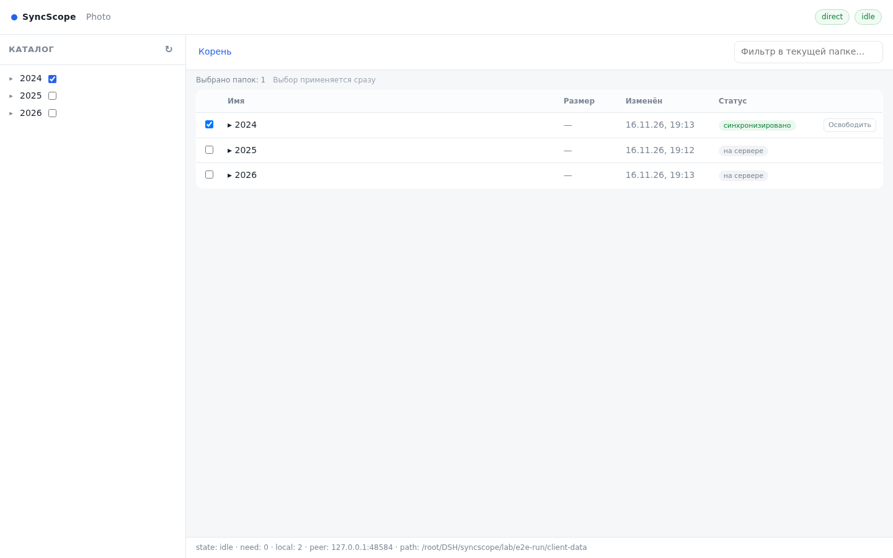

# SyncScope MVP

Вертикальный срез гибрида **Syncthing + собственный control plane** из
[плана](docs/plan.md): control plane, два агента,
локальный UI-навигатор и end-to-end стенд с двумя настоящими Syncthing.

## Что уже работает

- Control plane: устройства, библиотеки, гранты, каталог, отзыв.
- Живой каталог: fsnotify + debounce, версия каталога в API.
- Origin agent: создаёт одну Syncthing-папку на библиотеку, раздаёт её устройствам.
- Client agent: создаёт локальную `receiveonly`-папку и ставит whitelist `.stignore`.
- Локальный UI-навигатор: дерево, хлебные крошки, tri-state выбора папок, статусы.
- Выбор папки: скачивается только выбранное поддерево.
- Исключения внутри выбранной папки.
- «Освободить место»: ignore → scan → удаление локальной копии.
- Отзыв устройства: удаление из папок origin.
- E2E на Syncthing v2.1.7 с двумя инстансами (включая UI и free space).

## Чего пока нет

- OIDC: используются admin/device tokens.
- Выбор **отдельного файла**: Syncthing разворачивает `!/parent` в `!/parent/**`
  и тянет соседей. Это проверено в e2e; UI предлагает родительскую папку.
- Placeholders, мобильный клиент, relay-тест, Postgres (сейчас JSON-файл).
- Браузерный UI, не desktop-оболочка: позже обернуть в Tauri/WebView и добавить трей.

## UI



Запуск UI на локальном клиенте:

```bash
./bin/syncscope-client -ui 127.0.0.1:8099 ... -select 2024
# открыть http://127.0.0.1:8099
```

UI обслуживается самим клиентским агентом: device token не попадает в браузер,
выбор хранится локально в `-state`, каталог проксируется из control plane.
Дерево грузится лениво; у папок tri-state, у файлов выбор disabled.

## Быстрый старт

Нужен Go 1.27+ и Python 3.11+.

```bash
make build
make test
make fetch-syncthing
make e2e
```

`make e2e` поднимает control plane, два Syncthing, создаёт библиотеку, выбирает
папку, проверяет синхронизацию, исключение и отзыв. Ожидаемый вывод: `E2E PASS`.

## Компоненты

| Бинарь | Назначение |
|---|---|
| `bin/syncscoped` | Control plane API + JSON store + crawler |
| `bin/syncscope-origin` | Приводит Syncthing origin к желаемому состоянию |
| `bin/syncscope-client` | Создаёт локальную папку и применяет выбор |
| `internal/ignore` | Генератор whitelist `.stignore` + тесты |
| `internal/syncthing` | Минимальный REST-клиент Syncthing |
| `internal/store` | Устройства, библиотеки, гранты, каталог |
| `internal/crawler` | fsnotify-обновление каталога |
| `internal/webui` | Локальный UI-навигатор и selection state |
| `lab/e2e.py` | E2E-стенд с двумя Syncthing |

```
UI ── client agent ── control API ── store/catalog
                         │
               origin agent ── local REST ── Syncthing origin (sendonly)
                         │
                    client agent ── local REST ── Syncthing client (receiveonly)
```

## API

```bash
# 1. Создать устройство
curl -s -X POST http://127.0.0.1:8088/v1/devices \
  -H 'X-Admin-Token: dev-admin-token' -H 'Content-Type: application/json' \
  -d '{"name":"laptop","syncthing_id":"XXXX-...","address":"tcp://192.0.2.10:22000"}'
# => {"device":{...,"id":"dev-..."},"token":"..."}

# 2. Создать библиотеку (каталог обходится сразу)
curl -s -X POST http://127.0.0.1:8088/v1/libraries \
  -H 'X-Admin-Token: dev-admin-token' -H 'Content-Type: application/json' \
  -d '{"name":"Photo","root_path":"/srv/library/photo"}'

# 3. Дать устройству доступ
curl -s -X POST http://127.0.0.1:8088/v1/libraries/lib-xxxx/grants \
  -H 'X-Admin-Token: dev-admin-token' -H 'Content-Type: application/json' \
  -d '{"device_id":"dev-xxxx"}'

# 4. Каталог глазами устройства
curl -s http://127.0.0.1:8088/v1/catalog/lib-xxxx?parent=2024 \
  -H "Authorization: Bearer $DEVICE_TOKEN"
```

| Метод | Путь | Доступ |
|---|---|---|
| POST | `/v1/devices` | admin |
| GET | `/v1/devices` | admin |
| POST | `/v1/devices/{id}/revoke` | admin |
| POST | `/v1/libraries` | admin |
| GET | `/v1/libraries` | device |
| POST | `/v1/libraries/{id}/grants` | admin |
| GET | `/v1/catalog/{id}?parent=` | device |
| GET | `/v1/origin/libraries` | admin |
| GET | `/v1/health` | — |

Токены: `X-Admin-Token` для админских вызовов, `Authorization: Bearer` для
устройства. Дефолтный admin token — `dev-admin-token`; в реальном deployment
задайте `SYNCSCOPE_ADMIN_TOKEN`.

`state.json` содержит device-токены. Держите его с правами `0600`, не коммитьте
и не отдавайте наружу. Control API слушает localhost; в production — за TLS-прокси.

## Запуск вручную

```bash
# control plane
./bin/syncscoped -addr 127.0.0.1:8088 -data data/state.json

# origin agent: раз в 10 секунд сверяет библиотеки
./bin/syncscope-origin \
  -control http://127.0.0.1:8088 \
  -syncthing http://127.0.0.1:8384 \
  -syncthing-key "$ORIGIN_API_KEY"

# client agent: выбрать /2024 и ждать синхронизации
./bin/syncscope-client \
  -control http://127.0.0.1:8088 -token "$DEVICE_TOKEN" \
  -syncthing http://127.0.0.1:8385 -syncthing-key "$CLIENT_API_KEY" \
  -library lib-xxxx -local ~/Sync/photo \
  -origin-device "$ORIGIN_DEVICE_ID" -origin-address tcp://127.0.0.1:22000 \
  -select 2024 -wait
```

## Тесты

```bash
go test ./...
go vet ./...
python3 lab/e2e.py
```

`internal/ignore` покрыт golden-тестами: выбор папки, вложенность, исключения,
экранирование, запрет `..` и выбор файла.

## Следующие шаги

1. Заменить JSON store на Postgres и добавить OIDC device flow.
2. Обернуть UI в desktop-оболочку (Tauri/WebView), добавить трей и автозапуск.
3. Проверить relay pool в стенде (force relay на двух NAT-подобных инстансах).
4. Placeholders и мобильный клиент.
5. Собрать Windows/macOS пакет с встроенным Syncthing.
